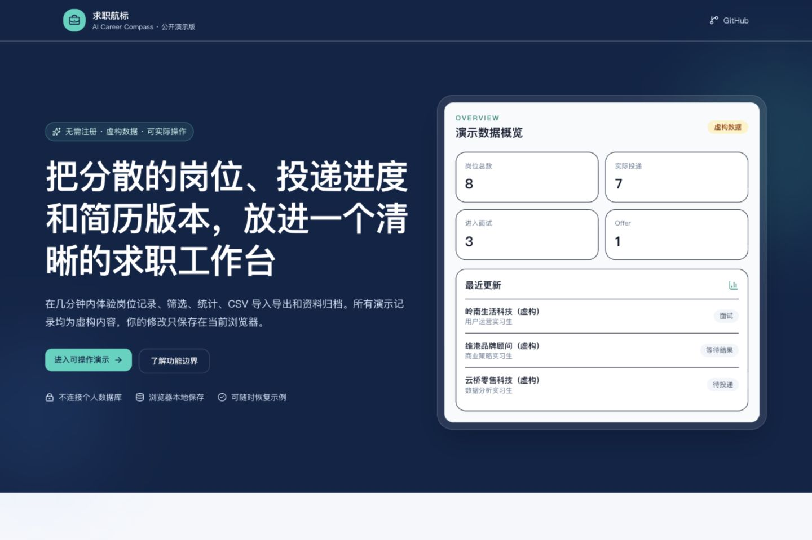
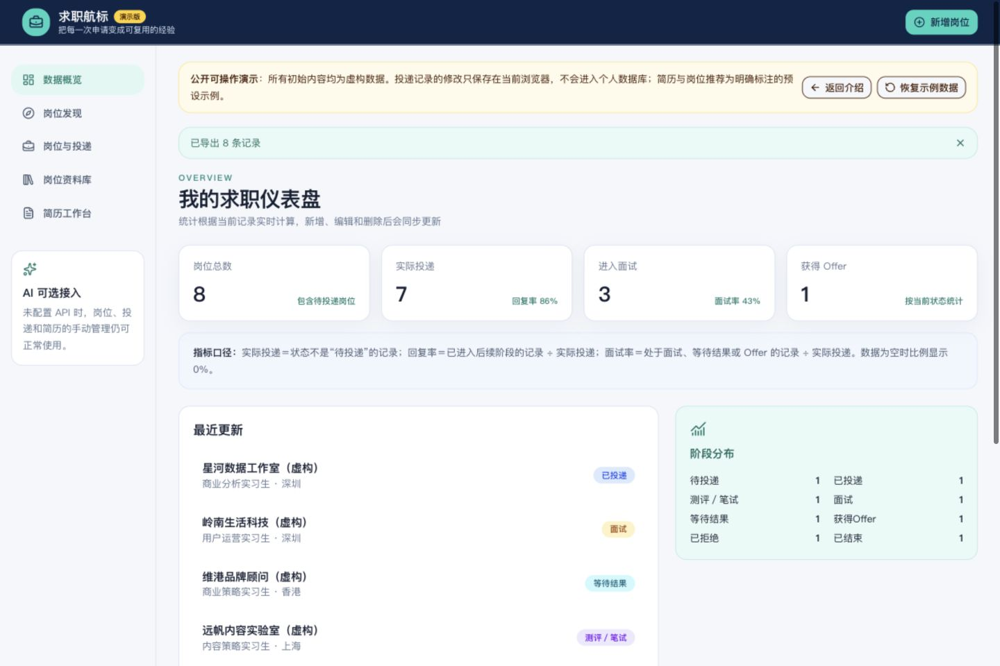
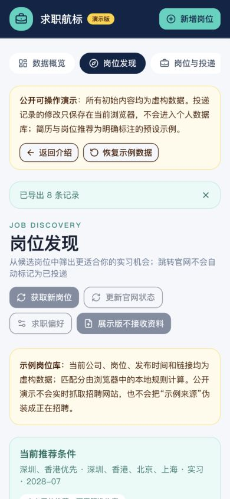

# 求职航标 Job Compass

一个中文个人求职管理网站，用于集中保存岗位、追踪投递、整理资料，并基于已确认的真实经历制作岗位定制简历。个人版可在本地完整使用；公开演示版使用虚构数据，并把每位访客的修改隔离在各自浏览器中。AI 是可选能力；不配置 API Key 时，手动录入、批量表格导入和日常管理仍可使用。

## 演示版预览





手机端会把导航、筛选和岗位卡片改为适合窄屏的布局：



## 已完成功能

- 岗位信息与投递记录分开保存；新增岗位默认“待投递”，日期不会自动填写
- 一个“新增岗位”入口，包含快速新增和批量导入
- 多段岗位文字、多行链接、多张截图、CSV、Excel 导入
- 导入前表格确认、直接编辑、批量设置、草稿、去重选择、失败项保留、重复点击保护和整批撤销
- 八种求职进度与表格内快速更新
- 按关键词、进度、岗位类别、地点筛选，并按更新时间、投递日期、公司排序
- 公司介绍、JD、任职要求、面试经验、笔试资料、常见问题和准备笔记
- CSV/Excel 列名映射、CSV 筛选结果导出
- PDF/DOCX 基础简历解析与人工确认，原文件和基础内容保留并可随时预览
- 单岗位 AI 分析、事实依据清单、原文/修改稿对照、岗位专属版本保存
- DOCX 导出与浏览器标准 PDF 打印；编辑投递时可从基础简历或岗位定制版本中选择实际使用版本
- 基础简历和定制版本支持删除；被历史投递引用时会阻止删除并提示先更换关联
- 独立“岗位发现”页面，候选岗位与正式投递数据隔离保存
- 可编辑求职偏好、硬条件筛选、透明的本地匹配分与推荐依据
- 为你推荐、相似岗位、最新岗位、已收藏四个栏目
- 公司、岗位方向、城市、招聘类型和匹配度筛选
- 收藏、查看、不感兴趣原因、官网跳转和手动确认投递
- 候选岗位文字、CSV、Excel 导入与重复岗位跳过
- 投递总数、回复率、面试率、Offer 数量和阶段分布
- 桌面端和手机端自适应中文界面
- 本地持久化数据库，刷新后数据仍存在
- 公开演示模式：无需注册，可在浏览器本地完成新增、编辑、删除、状态更新、筛选和 CSV/Excel 导入导出
- 每位访客的数据由浏览器 `localStorage` 隔离，可一键恢复虚构示例数据
- 公开演示的简历与岗位发现使用明确标注的预设样例；服务端拒绝写入、上传、外部抓取和 AI 调用

## 项目分工

- 项目所有者负责提出真实使用需求、梳理岗位与投递流程、确定产品取舍，并在持续使用中完成测试和反馈迭代。
- Codex 作为开发辅助工具，参与代码实现、测试、调试和文档整理。
- 页面中的产品能力、限制和演示状态均按实际实现描述，不把预设结果描述为实时 AI 或实时招聘抓取。

## 技术方案

- 前端与服务端：Next.js 16、React 19、TypeScript
- 样式与组件：Tailwind CSS、项目内置 UI 组件
- 数据库：Cloudflare D1（SQLite 兼容）
- 数据访问：Drizzle ORM
- 部署：Cloudflare Workers 兼容构建
- 测试：Node.js 内置测试工具

选择这套方案的原因是：一个代码仓库即可维护前端、接口和数据库；TypeScript 能提前发现字段错误；SQLite 结构直观；目前无需购买服务器或数据库。

## 本地运行

### 1. 安装工具

安装 [Node.js 22 或更高版本](https://nodejs.org/) 和 [Git](https://git-scm.com/downloads)。打开“终端”（Windows 使用 PowerShell），输入：

```bash
node --version
git --version
```

看到版本号就表示安装成功。

### 2. 下载并安装项目

```bash
git clone https://github.com/susie041720/job-compass.git
cd job-compass
npm install
```

### 3. 建立本地数据库并启动

```bash
npm run db:generate
npm run build
npm start
```

终端显示本地地址后，用浏览器打开它。开发界面时也可以运行 `npm run dev`。

### 4. 检查是否成功

- 首页能看到“求职航标”
- 点击“新增投递”可以填写并保存
- 刷新页面后记录仍然存在
- `npm test` 显示测试通过

如果你正在开发界面，可以改用：

```bash
npm run dev
```

默认从终端显示的本地地址打开，通常是 `http://localhost:5173/`。公开演示使用独立的 Cloudflare Workers 配置，不会复制本地个人数据。

## 公开作品站

在线体验（推荐）：<https://susie041720.github.io/job-compass/>

Sites 备用地址：<https://job-compass-susie.siqic25.chatgpt.site/>（部分微信内置浏览器可能拦截）

公开部署使用 Cloudflare Workers。`PUBLIC_DEMO_MODE=true` 时，页面会显示独立介绍页和“演示版”标识。访客可实际新增、编辑、删除、筛选、更新状态、导入和导出投递记录；这些记录仅保存到访客自己的浏览器 `localStorage`，不会写入服务端或与其他访客共享。“恢复示例数据”可以随时清除本地修改。

服务端仍会拒绝新增、编辑、删除、上传、外部抓取和 AI 请求，形成第二层保护。公开版的简历工作台和岗位发现只读取代码中的虚构预设样例，不接收真实简历，不声称实时调用 AI 或抓取招聘网站。请勿把本地 `.wrangler` 数据库、真实简历、`.env` 或 API Key 上传到 GitHub。完整部署步骤见 [docs/PUBLIC_DEPLOYMENT.md](docs/PUBLIC_DEPLOYMENT.md)。

## 批量导入

点击“新增岗位”→“批量导入”。支持以下资料：

- 岗位文字：岗位之间用单独一行 `---` 分隔
- 招聘链接：每行一个；系统不会绕过登录、验证码或访问限制
- 招聘截图：可以一次选择多张，相同岗位填写相同“合并组”
- CSV、XLSX、XLS：上传后先确认列名映射

所有资料都会先进入确认表。公司或岗位名称缺失的行可以保存为草稿，不会阻止其他有效记录保存。可使用 [examples/applications.csv](examples/applications.csv) 作为表格模板。

## AI 配置与隐私

复制 `.env.example` 为 `.env`，只在本机填写：

```bash
AI_PROVIDER=openai-compatible
AI_API_KEY=你的密钥
AI_MODEL=供应商支持的模型名称
AI_API_BASE_URL=https://供应商提供的兼容接口地址/v1
```

接口使用 OpenAI 兼容格式，因此服务商、模型和地址都可以替换。费用由你选择的服务商按调用量收取；建议先在服务商后台设置消费上限。项目不会自动重试失败的 AI 请求，以免重复扣费。

API Key 只从服务端环境变量读取，不会写入前端、浏览器存储或日志。发送简历前会再次提示，服务端会隐藏常见邮箱、手机号和住址。请不要把 `.env`、真实简历或真实求职数据提交到 GitHub；这些文件已被忽略。

## 岗位发现

进入侧边栏“岗位发现”，先在“求职偏好”中选择用于匹配的基础简历，并填写城市、招聘类型、毕业时间和最早到岗时间。目标方向可以留空，系统会根据已确认简历寻找相关和相邻岗位，也可以随时用页面筛选器收窄范围。

候选岗位与现有岗位库分开保存。查看、收藏和点击官网不会改变投递统计；只有在岗位详情中点击“我已完成投递”并再次确认，岗位才会去重后加入“岗位与投递”。日期不清楚时仍可留空。

第一版支持手动填写、多段岗位文字、CSV、Excel 和已验证的公开官网链接。当前可自动读取字节跳动校园招聘，以及使用 Greenhouse 的 CASETiFY、Flow Traders 官方岗位页；导入前都会进入确认表，不会直接创建投递记录。系统按来源岗位 ID、规范化链接或公司+岗位+地点去重。匹配分是本地可解释的估算结果，详情页会分别显示推荐理由、待确认条件和明确不符合项。

“更新官网状态”会重新读取已支持的官方岗位，更新 JD 和最近检查时间；官网明确返回不存在时才标记“可能已关闭”。网络超时或限流不会覆盖已有数据。对需要登录、验证码或未验证来源的链接，系统会停止读取并提示改用 JD 文字或表格。

## 当前边界

- 公开演示版的投递修改保存在当前浏览器；清除网站数据、使用隐私浏览或更换设备后不会保留。
- 公开演示版不开放真实 AI、截图识别、简历上传或实时岗位抓取；这些页面只展示明确标注的虚构输入与预设结果。
- 截图提取和岗位定制 AI 需要自行配置兼容 API；未配置时会明确提示，不会生成伪结果。
- PDF/DOCX 导出使用稳定的标准模板，不承诺无损还原上传文件的原排版。
- 招聘链接不会读取需要登录、验证码或访问受限的页面；请用截图或文字补充。
- 官方来源目前只接入少量已验证公司。腾讯、四大和更多中小公司会在确认其公开接口或允许访问的页面后逐步加入。
- 岗位发现页的“获取新岗位”会从已验证的公开接口读取新的实习岗位并去重；“更新官网状态”只复查已有岗位是否仍开放。
- 当前自动来源包括 OPPO、CASETiFY、Flow Traders、Lalamove、Ekimetrics 和 Airwallex。腾讯、美团、得物、小红书、大疆、华为、vivo、携程、Klook、汇丰、毕马威等已提供官网入口，尚未确认稳定公开接口的来源不会绕过限制自动读取。
- “换一批岗位”会跳过本浏览器已经看过的候选，并排除已投递、不感兴趣、可能关闭及硬性条件不符的岗位；“重新浏览候选”可以清空本地浏览批次记录。
- 岗位发现目前使用本地规则匹配；AI 逐条证据分析将在官方来源稳定后接入。
- 公开展示项目时请只使用虚构示例数据。
- 浏览器快捷收藏和批量生成多份定制简历留到第三阶段，根据实际使用反馈再决定。

详细产品和数据设计见 [docs/PRODUCT_PLAN.md](docs/PRODUCT_PLAN.md)。

## 常用命令

```bash
npm run dev
npm run build
npm start
npm test
npm run db:generate
```

## 考核记录与岗位分类

投递编辑中的“考核安排与历史”支持逐轮记录 OA、笔试、录制视频、AI 面试、真人面试及群面。可填写轮次、线上/线下、预约/截止时间、平台链接、准备笔记和完成情况。新增考核不会自动改变主要进度；旧“笔试”状态在界面显示为“测评／笔试”，数据库值兼容保留。考核记录保存在岗位上，切换回待投递也不会清空历史。时间为手工输入的当地时间，跨时区安排请注明时区。

快速新增、投递编辑和批量导入的“对照”面板可选择主类别、细分方向或自定义类别。本地关键词建议会显示依据；AI 提取岗位时同时返回分类建议，快速新增需点击确认采用。批量表格类别可直接修改，保存即确认。不会额外调用 AI 或产生分类费用；本地规则无法判定时显示待确认。

已有部署升级前，先备份数据库，再执行 `drizzle/0005_equal_aaron_stack.sql`（新增 `jobs.assessment_history` 列，不删除旧数据）。本次本地数据库已备份并升级，备份位于被 Git 忽略的 `.wrangler/backups/`。公开展示站尚未发布本次更新。
